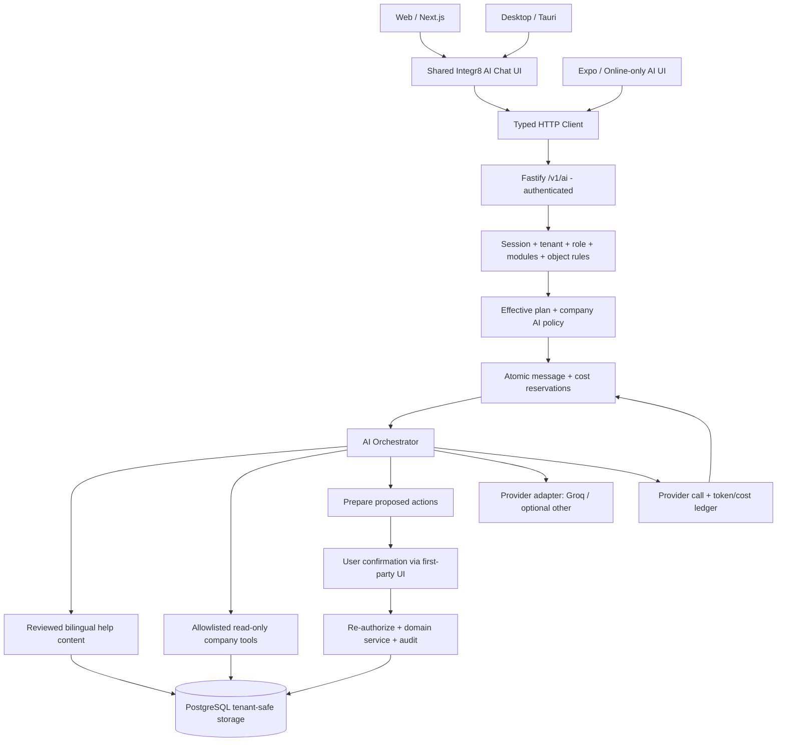

# Integr8 Plus — Subscription-Controlled AI Assistant

**Implementation specification and Claude Code execution brief**  
**Prepared:** 15 October 2026  
**Target:** `MinaLouisLeon/integr8-plus`, `main`, product version `1.1.0` as inspected  
**Status:** Design / implementation instructions — no repository changes have been made by this document  
**Ownership:** Integr8 platform administrators control AI subscriptions, tenant configuration, usage policy, providers and costs.

> **Primary requirement.** Implement one integrated AI assistant with three cumulative capability levels — **Help (L1)**, **Insights (L2)** and **Agent (L3)** — selectable for **each company** according to its subscription, with optional per-company overrides and strictly enforced **daily and/or monthly usage limits**. AI must be safe for a multi-tenant commercial SaaS and work in Arabic and English. Build against the existing codebase, not a parallel product.

## 0. Mandate and definition of success

The feature is complete only when:

1. Integr8 admins edit the default AI level and quotas for each existing `trial`, `starter`, `standard`, and `enterprise` subscription from the platform dashboard.
2. Integr8 admins select **Inherit plan** or **Custom** for any company, including a different AI level and daily/monthly limits, without changing its core subscription or billing mode.
3. An authenticated company user receives L1/L2/L3 only if the **effective tenant AI policy** allows it; custom roles, supplemental grants, module activation, object-level permissions and impersonation boundaries continue to apply.
4. The system enforces tenant-wide **daily, monthly, daily + monthly** caps, plus optional per-user caps; no concurrent requests can oversubscribe them.
5. L1 answers help/how-to questions from reviewed Integr8 documentation with Arabic/English responses, UI-specific links, citations and an honest unknown-answer behavior.
6. L2 answers authorized **read-only** company questions via allowlisted application tools; the model never receives database credentials, writes SQL, or searches other tenants.
7. L3 prepares bounded operations, displays exact previews, asks for **explicit user confirmation**, re-authorizes the same immutable action on the server and executes existing business rules with idempotency and audit logging.
8. Every user-visible answer consumes at most **one successful chat-message unit**, including any internal tool calls; provider tokens, input/output costs and retries are separately metered.
9. Server-only provider keys and operational limits cannot be modified or read by tenant users; no default paid or proprietary software dependency is required.
10. All affected web and desktop UI plus the supported mobile experience have both English and Arabic text, RTL support, accessible controls and meaningful failure states.
11. Unit, integration, authorization, concurrency, migration and rollback tests pass; generated OpenAPI client and package-license checks remain in sync.
12. Default rollout is **off** for every subscription until an Integr8 administrator explicitly enables AI in plan settings or for an individual company. There must be a platform-level emergency kill switch as well.

### Terminology

| Term                  | Definition                                                                                                         |
| --------------------- | ------------------------------------------------------------------------------------------------------------------ |
| **L0 / off**          | Assistant unavailable to company.                                                                                  |
| **L1 / help**         | Document-grounded support, navigation, product instructions.                                                       |
| **L2 / insights**     | L1 plus permission-filtered, read-only company data summaries.                                                     |
| **L3 / agent**        | L2 plus restricted, user-confirmed state changes.                                                                  |
| **Plan default**      | AI policy for all companies on a named subscription unless overridden.                                             |
| **Company override**  | Complete, explicit policy replacing the plan's AI defaults for one company.                                        |
| **Chat message unit** | One successfully completed user request to the assistant, irrespective of the number of internal LLM/tool calls.   |
| **Provider call**     | One external model invocation, possibly more than one per message unit.                                            |
| **Usage reservation** | Pre-provider, atomic capacity reservation for one idempotent user message.                                         |
| **Effective policy**  | Company custom settings, if enabled; otherwise current plan default; further restricted by global safety settings. |

---

## 1. Verified current repository architecture

The following items were inspected in GitHub on 15 October 2026. **Claude Code must re-read the current branch before coding**: the repository may change after this document's generation.

| Existing component                                                    | Verified responsibility                                                                             | Required extension                                                                             |
| --------------------------------------------------------------------- | --------------------------------------------------------------------------------------------------- | ---------------------------------------------------------------------------------------------- |
| `apps/api/src/index.ts`                                               | Long-lived Fastify API process; route registration.                                                 | Wire in AI routes and services.                                                                |
| `apps/api/src/routes/index.ts`                                        | Central route manifest feeding OpenAPI.                                                             | Register `/v1/ai/*`.                                                                           |
| `apps/api/src/routes/v1/platform/index.ts`                            | Separate platform-admin routes, `security: 'platform'`.                                             | Register AI administration APIs.                                                               |
| `apps/api/src/http/routes.ts`                                         | `defineRoute`, schema, auth, permissions, feature and idempotency declarations.                     | Use for ordinary JSON AI endpoints; assess stream transport separately.                        |
| `apps/api/src/server.ts`                                              | Authentication, authorization, rate limiting, tenant status/read-only checks and idempotency hooks. | Preserve all protections for AI; add no unauthenticated bypass.                                |
| `apps/api/src/composition.ts`                                         | Provider-agnostic service composition root.                                                         | Build `AiProvider` and orchestrator, recording fake in tests.                                  |
| `apps/api/src/config.ts`                                              | Zod-validated server environment configuration.                                                     | Add secrets, provider model IDs, timeouts, budgets and kill switch.                            |
| `apps/api/src/billing/entitlements.ts`                                | Plan allowances for seats, storage and monthly submissions.                                         | Add AI policy resolution through a dedicated service, not by weakening current limits.         |
| `apps/api/src/media/quota.ts`                                         | Plan allowance caching with invalidation.                                                           | Reuse cache patterns; keep AI limits separately typed and short-lived.                         |
| `apps/api/src/routes/v1/platform/settings.ts`                         | Feature-flag definitions and tenant overrides.                                                      | Follow admin authorization/audit conventions; AI policy must have one authoritative source.    |
| `apps/api/src/routes/v1/platform/companies.ts`                        | Company profile, plan and billing-mode management.                                                  | Return company's effective AI policy, override and usage.                                      |
| `apps/web/src/app/platform/(dashboard)/plans/page.tsx`                | Editable plan allowance UI.                                                                         | Add AI defaults to plan panels or a clearly linked AI sub-panel.                               |
| `apps/web/src/app/platform/(dashboard)/companies/[tenantId]/page.tsx` | Company administration screen.                                                                      | AI Access & Usage panel and override editor.                                                   |
| `packages/db/src/connection.ts`                                       | `TenantTransaction`, `PlatformDataSource`, `withTenant` and repository registration.                | Add tenant AI repositories and minimal platform AI administration repositories.                |
| `packages/db/src/schema.ts`                                           | Typed Kysely database schema and exhaustive `TENANT_SCOPED` mapping.                                | Register all new tables, table interfaces and tenant-scope classifications.                    |
| `packages/db/src/tenant-guard.ts`                                     | Rejects unscoped tenant SQL.                                                                        | Keep all AI tenant tables covered.                                                             |
| `packages/db/migrations/0043_opportunity_amounts.up.sql`              | Latest numbered migration visible during review.                                                    | Create next available **up and down** migrations (likely `0044`, verify).                      |
| `packages/db/src/repositories/rate-limits.ts`                         | Fixed-window abuse counter, before/after auth.                                                      | **Do not reuse as financial/message quota meter**; it is not a durable usage ledger.           |
| `packages/core/src/permissions.ts`                                    | Central matrix, custom roles, grants, staff-only checks (`holds`/`assertHolds`).                    | Add AI-specific permissions carefully; respect all existing business permissions for AI tools. |
| `packages/core/src/crm.ts`                                            | Module-feature keys such as `crm`, `finance`, `inventory`.                                          | Check downstream tool/module access, do not equate AI level with module permission.            |
| `packages/core/src/navigation.ts`                                     | Shared web/desktop navigation metadata.                                                             | Add AI entry only if UI navigates to a full AI page.                                           |
| `packages/operations-dom/src`                                         | Shared web and desktop business UI.                                                                 | Implement reusable AI chat panel and components here if compatible with its dependency rules.  |
| `apps/desktop/src/App.tsx`                                            | Tauri / React Router desktop app.                                                                   | Mount reusable assistant and show full-page route if needed.                                   |
| `apps/mobile`                                                         | Expo + offline-first field application.                                                             | Add an **online-only** assistant; never touch/offline-enqueue AI mutations.                    |
| `packages/i18n/src/messages/{en,ar}.ts`                               | Shared English/Arabic translations across the React apps.                                           | Add all `ai.*` / platform AI locale keys with correct RTL.                                     |
| `scripts/licences/check.mjs`                                          | Permissive-license dependency policy.                                                               | Run before merging any new AI SDKs or parsers.                                                 |
| `docs/operations/`, `docs/crm-erp/`, `docs/form-engine/`, etc.        | Technical documentation and domain rules.                                                           | Seed controlled product help articles, reviewed for end-user accuracy.                         |

**Repo invariants that cannot be broken:** TypeScript monorepo (`pnpm`/Turborepo), Next.js web, React/Tauri desktop, Expo mobile, Fastify typed routes, generated OpenAPI client, `@integr8/db` repositories only, tenant RLS plus tenant guard, central permission matrix, server-enforced feature gates, official shared i18n, append-only audit, immutable financial/workflow documents and an offline-first mobile field workflow.

**Scope distinction:** This assistant feature is separate from the previously planned P30 **AI form generation**. Never merge them by accident; future form generation may use the provider layer but receives its own product entitlement and permission review.

---

## 2. Non-negotiable product policies

### 2.1 Capability levels

| Capability                                            | Off | L1 Help |   L2 Insights    |               L3 Agent               |
| ----------------------------------------------------- | :-: | :-----: | :--------------: | :----------------------------------: |
| Product FAQ and troubleshooting                       |  —  |    ✓    |        ✓         |                  ✓                   |
| Arabic and English conversation                       |  —  |    ✓    |        ✓         |                  ✓                   |
| Help article citations and deep links                 |  —  |    ✓    |        ✓         |                  ✓                   |
| Explain disabled/unavailable modules                  |  —  |    ✓    |        ✓         |                  ✓                   |
| Read actual company objects                           |  —  |    —    | Permission-gated |           Permission-gated           |
| Summaries and filtered insights                       |  —  |    —    | Permission-gated |           Permission-gated           |
| Prepare action preview                                |  —  |    —    |        —         |         Whitelisted actions          |
| Persist application mutation                          |  —  |    —    |        —         | Whitelisted + confirmation + recheck |
| Raw SQL / file system / unrestricted shell            |  —  |    —    |        —         |              **Never**               |
| Autonomous financial approval/payment/record deletion |  —  |    —    |        —         |     **Never in initial release**     |

Levels are cumulative. A user **never** receives access merely because the company purchased L3. Their existing role, grants, module activation and object-level rules remain the final authority.

### 2.2 Subscription and company inheritance

- Existing plans: `trial`, `starter`, `standard`, `enterprise`. Do not rename or fork them.
- Every plan has an AI default policy editable by platform administrators.
- Every company has an override mode: `inherit` or `custom`.
- `inherit`: read the live default belonging to the company's effective current subscription. Upgrades/downgrades alter capability automatically after cache invalidation.
- `custom`: use an explicit full snapshot of AI settings independent of the subscription. On switch from inherit → custom, pre-populate the editor with resolved plan values; record provenance and timestamp.
- A separate **global `AI_ENABLED` kill switch** can block all requests, regardless of per-company entitlement. Default `false` in production until operator activation.
- Avoid introducing an extra `ai` module flag that creates conflicting truths (plan enabled but feature flag disabled). If a rollout flag is essential, make its precedence explicit and tested; AI entitlements remain the authoritative product-level entitlement.
- Only platform administrators may change plan defaults or company AI overrides. Company owners, admins and staff members can **view their allowance**, not edit it.
- AI policies are independent of how the company pays (`self_serve` or `invoiced`); changing AI limits does not silently change Stripe subscriptions or invoice amounts. AI charges/add-ons are a separate future business decision.

**Illustrative plan settings only, never hardcode as business truth:**

| Subscription | Level           | Daily limit | Monthly limit |
| ------------ | --------------- | ----------: | ------------: |
| trial        | off (initially) |           — |             — |
| starter      | off (initially) |           — |             — |
| standard     | off (initially) |           — |             — |
| enterprise   | off (initially) |           — |             — |

Once enabled in the admin dashboard, examples might be trial=Help/10 per day, starter=Help/300 per month, standard=Insights/1,500 per month and enterprise=Agent/5,000 per month. **No free tier or trial tier is automatically provisioned with billable AI usage.**

### 2.3 Quota semantics — locked decisions

1. The **tenant-wide** allowance is pooled across all users in that company.
2. Admin can choose `daily`, `monthly`, or `daily_and_monthly`; both checks must pass when both are active.
3. One assistant answer **durably completed and stored for replay** counts as **one message**, even if the client connection subsequently drops before receiving the response. A request that fails before an answer is committed does not permanently consume its message allowance. Retried idempotent requests cannot count twice.
4. Optional per-user daily and/or monthly limits apply additionally to the tenant-wide limits; they cannot expand tenant capacity.
5. Use UTC fixed **calendar** periods: day `[00:00, next 00:00) UTC` and calendar month `[day 1 00:00, next month day 1 00:00) UTC`. Show the user a localized representation of `resetsAt`.
6. Current period consumption is never erased on a plan change. The **new configured cap** takes effect against the existing usage in that period. Reducing below used blocks new messages; increasing unlocks remaining capacity.
7. `daily_limit = null` means the daily axis is not configured, **not** unlimited total usage. Same for monthly. An active tenant must have at least one finite positive limit, except a specifically authorized admin configuration with `unlimited_messages = true` and a finite cost ceiling.
8. Do not implement rollover of unused messages, auto-refill, automatic paid overage or extra message packs in V1.
9. For successful L3 messages, all internal read and write tools and provider calls are included in the one message unit. Subsequent confirmation of an already prepared action does **not** consume a second chat-message unit; it is tracked as an action execution and can incur no extra model call by default. **Costs and tool executions are separately logged** and bounded by model-call/step caps.
10. UI must show `used`, `reserved`, `limit`, `remaining`, `resetsAt`, and whether a limit is active. Reserved slots must count against admission to prevent concurrency bypass.
11. Provider request/day limits belong to your **provider organization**, not to each Integr8 company. Treat them as separate capacity constraints; per-company quotas are your own accounting.
12. Internal cap on concurrent AI requests per tenant/user and per provider, independent of daily/monthly totals.

**Example:** A company assigned L3, 50/day, 1,000/month, 10/day/user has used 32 today and 620 this month. It may accept at most 18 more today, 380 more this month, and no individual user may exceed 10 today. If a user requests a fifth internal tool during an already admitted message, it does not take an additional chat unit, but tool-step caps and token/cost ceilings still apply.

### 2.4 Fail closed for cost and security

- If policy lookup or durable quota reservation is unavailable, do **not** call the model.
- Do not mark any request `success` until the complete, valid answer is persisted for replay. Network delivery acknowledgements are not a reliable charging boundary.
- Reserve bounded model-cost capacity; record actual usage and provider billing data, including partial/failed/unknown-cost calls.
- Provider 429/outage produces a clear temporary-unavailable response, not an automatic relaxation of company limits.
- Global provider monthly cost budgets, optional tenant cost budgets, per-message input/output-token limits and model-call limits must be enforced before requests.
- If a provider cannot return reliable token usage, estimate conservatively and flag `estimated` in the usage ledger.
- No provider API key in browser, Tauri renderer, Expo bundle, chat history, telemetry, stack trace or logs.

---

## 3. End-to-end reference architecture



**Call flow:** authenticate → verify tenant served → effective policy + capability → authorization/tool permission checks → admission reservation → relevant documentation/company data → provider → validate outputs → persist answer/usage → release/reconcile reservations → respond to user. L3 action preparation and confirmation are **separate endpoints and separately authenticated operations**.

### 3.1 Suggested folder layout (adjust after checking actual imports)

```text
apps/api/src/ai/
  ai-service.ts                 # top-level orchestration
  entitlements.ts               # effective policy calculation, cache, invalidation
  quotas.ts                     # atomic admission, settle, cancel, recover
  providers/
    types.ts                    # provider-neutral interface and usage info
    recording.ts                # deterministic fake, failure injection
    groq.ts                     # OpenAI-compatible API adapter
    gemini.ts                   # optional paid-compatible adapter
    registry.ts                 # configured allowlisted provider/model selection
  knowledge/
    indexer.ts                  # idempotent curated help import
    retrieve.ts                 # bilingual search + source metadata
  tools/
    registry.ts                 # tier, permission and module annotations
    help.ts
    work-orders.ts
    crm.ts
    finance.ts
    inventory.ts
  actions/
    proposals.ts                # typed, immutable, expiring action proposals
    execute.ts                  # domain validation + immutable intent execution
  safety/
    redact.ts
    prompt.ts
    limits.ts
    tool-validation.ts
apps/api/src/routes/v1/ai.ts
apps/api/src/routes/v1/platform/ai.ts
packages/db/src/repositories/ai-*.ts
packages/db/migrations/00XX_ai_*.up.sql
packages/db/migrations/00XX_ai_*.down.sql
packages/core/src/ai.ts
packages/operations-dom/src/ai/
  ai-assistant.tsx
  ai-chat.tsx
  ai-usage.tsx
  ai-action-preview.tsx
apps/web/src/app/(app)/ai/page.tsx
apps/mobile/src/...                  # follow current mobile screen/layout conventions
packages/i18n/src/messages/en.ts
packages/i18n/src/messages/ar.ts
```

Prefer the existing generated `@integr8/api-client` for normal JSON endpoints, not ad-hoc fetch wrappers. Reuse current components and patterns instead of adding an unneeded UI framework, background queue, separate vector database, LangChain orchestration server or a second authentication system.

---

## 4. Database architecture and migrations

### 4.1 Migration implementation rules

- Determine the next unused migration number at implementation time (`0044` was likely next on the inspected branch). Create matching `.up.sql` and `.down.sql`; never rewrite applied migrations.
- Use existing Postgres naming, primary key, `tenant_id`, composite tenant foreign key, `created_at`/`updated_at`, triggers and permissions conventions.
- Introduce typed Kysely tables in `packages/db/src/schema.ts`, update its `Database` type, `PLATFORM_TABLES`, exhaustive `TENANT_SCOPED` mapping, and the exported repository interfaces.
- Register repositories in `packages/db/src/connection.ts` and exports in `packages/db/src/index.ts`. **No direct Kysely/pg usage from apps/api**.
- Every tenant-facing table has `tenant_id`, RLS `USING (tenant_id = app_current_tenant_id())` and appropriate `WITH CHECK`; add only minimum `integr8_app` grants. `integr8_auth` must not gain access.
- Global plan/config/provider-price tables must have platform-only writes; avoid exposing tokens or pricing/secret configurations to tenant clients.
- Preserve delete/export lifecycle. Tenant-owned chats, usage, proposed actions and attachments must be exported or deleted with the company using the established lifecycle machinery. Anonymized platform-only spend reports may be retained according to a disclosed retention policy.
- Run the existing schema invariants, tenant isolation and migration rollback tests. Validate that new SQL security-definer functions, if any, use restricted `search_path` and enforce tenant context.

### 4.2 Tables and column contracts

These are **logical schemas**, not copy-paste SQL; adapt exact SQL types and repository interfaces to project conventions.

#### A. `ai_plan_policies` — platform-owned defaults

| Column                                  | Type / rule                                                               |
| --------------------------------------- | ------------------------------------------------------------------------- |
| `plan`                                  | `text PRIMARY KEY`, constrained to existing `TENANT_PLANS`                |
| `level`                                 | enum/check: `off`, `help`, `insights`, `agent`; default `off`             |
| `quota_mode`                            | `daily`, `monthly`, `daily_and_monthly`; null when `off`                  |
| `daily_limit`                           | positive int or null; non-null when mode has daily                        |
| `monthly_limit`                         | positive int or null; non-null when mode has monthly                      |
| `per_user_daily_limit`                  | positive int or null                                                      |
| `per_user_monthly_limit`                | positive int or null                                                      |
| `monthly_cost_cap_microusd`             | positive bigint or null (null permitted only if global cap still governs) |
| `max_input_tokens`, `max_output_tokens` | positive ints bounded by operator-controlled maxima                       |
| `max_tool_steps`, `max_provider_calls`  | positive bounded ints; L1 lower than L3                                   |
| `allow_history`                         | boolean default true; controls optional persistence policy                |
| `retention_days`                        | int positive, default 30; subject to tenant data policy                   |
| `version`, `updated_at`, `updated_by`   | optimistic update/audit metadata                                          |

Seed one `off` row per existing plan; SQL checks reject inconsistent modes and negative values.

#### B. `ai_tenant_policies` — platform-written company override

| Column                                      | Type / rule                                                                                                                        |
| ------------------------------------------- | ---------------------------------------------------------------------------------------------------------------------------------- |
| `tenant_id`                                 | UUID primary/composite scope, FK to `tenants`                                                                                      |
| `mode`                                      | `inherit` or `custom`                                                                                                              |
| `custom_policy`                             | Typed columns mirroring plan policies, or a versioned validated JSON schema; strongly prefer typed columns for querying/invariants |
| `version`                                   | monotonically increasing integer; compare-and-swap for concurrent edits                                                            |
| `updated_by_platform_user_id`, `updated_at` | changes recorded with platform actor identity                                                                                      |
| `reason`                                    | optional short admin reason, reflected in platform audit                                                                           |

When `mode=custom`, all required policy fields must be explicitly present and validated; null has its normal domain meaning, never implicitly inherit. When `mode=inherit`, custom fields are ignored. Provide a **Reset to plan** button, which switches to `inherit` without resetting usage counters.

#### C. `ai_usage_periods` — quota counters, one per subject and period

| Column                  | Type / rule                                                            |
| ----------------------- | ---------------------------------------------------------------------- |
| `tenant_id`             | UUID, tenant-scoped                                                    |
| `subject_type`          | `tenant` / `user`                                                      |
| `subject_id`            | UUID not null; for tenant-wide subject use tenant's UUID               |
| `period_type`           | `day` / `month`                                                        |
| `period_start_utc`      | UTC midnight date/timestamptz keyed exactly                            |
| `used_messages`         | int >= 0                                                               |
| `reserved_messages`     | int >= 0                                                               |
| `version`, `updated_at` | metadata                                                               |
| unique key              | `(tenant_id, subject_type, subject_id, period_type, period_start_utc)` |

A reservation counts as unavailable capacity until completed/released. For every request, lock applicable tenant day, tenant month, user day and user month counters in a **deterministic order within a single DB transaction**. Missing counters are inserted idempotently. Check `used + reserved + 1 <= effective_limit` under those locks, then increment `reserved` for every applicable counter or reject the entire transaction.

#### D. `ai_message_reservations` — idempotent admission state machine

| Column                                          | Type / rule                                                                           |
| ----------------------------------------------- | ------------------------------------------------------------------------------------- |
| `id`, `tenant_id`, `user_id`, `conversation_id` | UUIDs; tenant-safe references                                                         |
| `client_request_id`                             | caller UUID/idempotency key, required for chat POST                                   |
| `request_fingerprint`                           | hash of canonical intent + authenticated user, not an opaque cross-user shared replay |
| `state`                                         | `reserved`, `completed`, `released`, `expired`, `uncertain`                           |
| `reserved_message_units`                        | exactly `1` in V1                                                                     |
| `reserved_cost_microusd`                        | bounded, conservatively estimated cost                                                |
| `created_at`, `expires_at`, `settled_at`        | timestamps                                                                            |
| `provider_attempts`, `last_error_code`          | diagnostics without raw prompts                                                       |
| unique key                                      | `(tenant_id, user_id, client_request_id)`                                             |

Do not repurpose the general API idempotency implementation without checking its user scoping and replay behavior. An identical retry while `reserved` should answer **in progress**; completed replies may return the stored answer; mismatched payloads return 409. A timeout alone does not prove the provider incurred zero cost, so mark provider cost as uncertain until reconciled.

#### E. `ai_provider_calls` — independently recorded inference usage

`id`, `tenant_id`, `reservation_id`, `provider`, `model`, `attempt_number`, `purpose` (`help|insights|agent|other`), `input_tokens`, `output_tokens`, `cached_tokens`, `reasoning_tokens` when available, `tokens_estimated`, `cost_microusd`, `price_version`, `status` (`success|failed|timeout|unknown`), normalized error code, `started_at`, `ended_at`.

Use bigint/integer **USD micros** or another documented integer money representation, **never floating point money**. Quote rates from a versioned model-price catalog in server configuration or a platform-only table. A recorded cost is an estimate if exact provider billable usage is not supplied; display it as such. Provider calls may outnumber successful message units.

#### F. `ai_cost_periods` — tenant/provider budget reservations

Per tenant/calendar month store `spent_microusd`, `reserved_microusd`, optional `unknown_microusd`; atomically reserve enough worst-case budget to cover the permitted provider calls and output bound, then settle. Consider separate provider/model scoped columns if needed for granular reporting. Also implement a platform-wide monthly budget reservation using platform-owned counters: acquire the **global** reservation first, then tenant reservation; if the tenant fails, release global. Expiring orphaned global/tenant reservations must be recoverable idempotently. This two-stage admission can temporarily underutilize capacity but **must not overspend** either hard cap.

#### G. `ai_conversations` and `ai_messages`

`ai_conversations`: `id`, `tenant_id`, `created_by_user_id`, optional sanitized title, `locale`, `level_at_creation`, `created_at`, `updated_at`, `deleted_at`.

`ai_messages`: `id`, `tenant_id`, `conversation_id`, `user_id` (nullable for assistant), `role` (`user|assistant|tool_summary`), `content`, `source_refs` (validated metadata), `usage_reservation_id`, `created_at`, optional redaction flag. Never persist provider secret keys, tool access tokens, hidden sensitive prompts, raw provider traces, full HR records, access codes or bank account details. Prefer short history plus a retention cleanup job and user-visible clear-history action. Company history remains private to its owner unless a separate explicit delegated-review permission is approved.

If L3 audit requires preserving metadata longer than chat, store a **minimal, append-only action audit** separately; don't keep raw chat indefinitely to satisfy audit requirements.

#### H. `ai_action_proposals` and `ai_action_events`

`ai_action_proposals`: `id`, `tenant_id`, `user_id`, `conversation_id`, `tool_key`, `typed_payload_json`, `payload_schema_version`, `display_summary_json`, `request_digest`, `resource_versions_json`, `state` (`pending|confirmed|executing|completed|rejected|expired|failed`), `expires_at` (suggested 5 minutes), `confirmed_at`, `result_resource_id`, `execution_idempotency_key`, `created_at`. Payload cannot be edited once proposed; reprepare to change inputs.

`ai_action_events`: append-only state transitions with actor, action, proposal id, code, request correlation, timestamp and redacted details. Mirror meaningful business changes to the established `audit_log` using the original authenticated actor. Agent execution must not impersonate a privileged service account to bypass permission checks.

#### I. `ai_help_articles` and optional `ai_help_article_versions`

Platform-curated articles: stable `article_key`, `locale` (`ar|en`), `module`, `title`, `markdown`/plain-text content, `allowed_roles` if required, `help_url`, `app_route`, `search_keywords`, `source_commit`, `published_at`, `updated_at`, `content_hash`, `status`. Separate by product modules; do not index sample secrets or actual company data. Start with indexed, curated keyword/full-text search plus strong manually written Arabic terms; Postgres's default English full-text stemming is **not** an adequate Arabic retrieval strategy on its own. Optional vector indexing later only if measurable evaluation justifies it; avoid mandatory paid vector services.

### 4.3 Policy resolution algorithm

```typescript
// Domain-level pseudocode; do not copy into API without repository/auth adaptation.
type AiLevel = 'off' | 'help' | 'insights' | 'agent';

async function resolveEffectiveAiPolicy(tenantId: TenantId): Promise<EffectiveAiPolicy> {
  if (!config.AI_ENABLED) return disabledPolicy('global_off');
  const tenant = await platformSubscriptionAndStatus(tenantId);
  const planPolicy = await aiPlanPolicyRepository.find(tenant.effectivePlan);
  const override = await tenantAiPolicyRepository.findForTenant(tenantId);
  const resolved = override?.mode === 'custom' ? override.policy : planPolicy;
  return validateAndBoundByGlobalSafetyLimits(resolved);
}
```

- The tenant identity comes **only** from the verified principal, never from a client-supplied tenant field.
- Preserve current tenant suspension/read-only semantics. In the initial version, follow the API's existing rules: chat POST is unavailable when tenant is read-only/suspended; usage/status GET remains available if existing API policy permits. This behavior must be documented and tested.
- Subscription status and billing mode are read from current authoritative records, as existing entitlements do; avoid using potentially stale labels from UI state.
- Treat a missing plan policy as `off` (**fail closed**) rather than uncapped. Cache resolved policy briefly (suggest <=30 seconds) with explicit invalidation on admin changes; use database checks rather than cached counters for quota admission.
- Operators can set custom policies above or below plan defaults; restrict edits to platform actors and record both old/new values (excluding secrets) in platform audit.

### 4.4 Atomic admission lifecycle

**State machine:** `new -> reserved -> completed | released | uncertain -> reconciled`; a reservation ID is stable for retries.

1. Verify authentication, tenant status, AI level, role, optional capability tool and global emergency switch before allocating cost.
2. Validate requested message and history lengths; apply allowlisted model/token bounds.
3. Compute exact active UTC day/month counter keys and a conservative maximum provider cost for this message (including maximum allowed fallback and tool calls).
4. Acquire global-cost reservation transactionally; if denied, return an internal budget-exceeded error without leaking budget details to the tenant.
5. In one tenant-scoped DB transaction, claim `(tenant_id,user_id,client_request_id)` and reserve all applicable tenant/user message counters and tenant cost bound, with deterministic locks and one all-or-nothing commit. If rejected, release the global reservation.
6. Commit transactions **before** external calls. Never hold a DB transaction, advisory lock or pool connection while awaiting a model.
7. Execute provider/tool operations under a deadline and step limits; create a `ai_provider_calls` row per attempt.
8. Validate output, store assistant message, reconcile actual token/cost usage and settle reserved counters. A completed, durably persisted answer converts each reserved message slot to used once, regardless of subsequent network delivery failure.
9. On pre-delivery failure, release message reservation, settle any real provider costs and return localized error. On ambiguous network disconnection, mark the record `uncertain` and use a safe replay/reconciliation rule; do not blindly generate a second chargeable answer.
10. Worker/scheduled cleanup recovers stale reservations only after checking committed messages/proposals and attempts. Recovery must be idempotent across multiple workers.
11. Every admin modification to limits during active requests is checked for new admissions; already admitted requests may finish within their reserved cost. **Do not double charge** and do not forcibly cancel a confirmed domain action halfway through its transaction.

**Acceptance property:** Under 100+ simultaneous requests for a quota of 10, **no more than 10** successfully admitted requests may consume the same pool (including reserved), and each idempotency key counts at most once. Test boundaries at 23:59:59 UTC, 00:00:00 UTC, month transitions and leap days.

---

## 5. Typed API contracts

### 5.1 Tenant-facing endpoints

All tenant endpoints use the repository's normal bearer/session authentication, current tenant context, rate limit, idempotency rules and OpenAPI generation. Path parameter ownership checks are enforced server-side.

| Method   | Route                                           | Required level | Responsibility                                                                                                 |
| -------- | ----------------------------------------------- | -------------- | -------------------------------------------------------------------------------------------------------------- |
| `GET`    | `/v1/ai/capabilities`                           | Off allowed    | Effective level, allowed tools by this user's permissions, available status and links; never provider secrets. |
| `GET`    | `/v1/ai/usage`                                  | Off allowed    | Current tenant/user daily/monthly usage and reset timestamps.                                                  |
| `POST`   | `/v1/ai/conversations`                          | L1             | Create a private session with selected language.                                                               |
| `GET`    | `/v1/ai/conversations`                          | L1             | Paginated conversations owned by the current principal.                                                        |
| `GET`    | `/v1/ai/conversations/:conversationId`          | L1             | Session metadata and cursor-paginated messages; tenant + user ownership check.                                 |
| `DELETE` | `/v1/ai/conversations/:conversationId`          | L1             | User deletes own history (subject to minimal retained audit).                                                  |
| `POST`   | `/v1/ai/conversations/:conversationId/messages` | L1             | Admitted chat request, RAG/tools, response, citations and quota snapshot.                                      |
| `POST`   | `/v1/ai/actions/:proposalId/confirm`            | L3             | Confirm immutable action after fresh authorization and resource-version checks.                                |
| `POST`   | `/v1/ai/actions/:proposalId/reject`             | L3             | Explicitly reject pending proposal, auditable.                                                                 |
| `GET`    | `/v1/ai/actions/:proposalId`                    | L3             | Show own proposal/current status/result.                                                                       |

Protect `GET /v1/ai/usage` so regular users cannot inspect coworker identities or company financial cost breakdown. Show the aggregate shared tenant quota and their own per-user counters; sensitive provider spending available only to platform operators (or explicitly permissioned company administrators as a later opt-in).

**Suggested request/response for message endpoint:**

```json
POST /v1/ai/conversations/{conversationId}/messages
Idempotency-Key: e0df5a2d-f13b-4cff-9283-2368883b8c6b
{
  "message": "كم أمر عمل متأخر عندي اليوم؟",
  "locale": "ar",
  "clientContext": { "page": "work_orders", "entityId": null }
}
```

```json
200 OK
{
  "message": {
    "id": "uuid",
    "role": "assistant",
    "text": "لديك 3 أوامر عمل متأخرة ...",
    "sources": [{ "kind": "help", "articleKey": "work_orders_overview", "label": "إدارة أوامر العمل", "url": "/help/work-orders" }],
    "toolSummaries": [{ "tool": "my_work_orders_summary", "result": "3 overdue" }],
    "actionProposal": null
  },
  "usage": {
    "daily": { "used": 4, "reserved": 0, "limit": 10, "remaining": 6, "resetsAt": "2026-10-16T00:00:00Z" },
    "monthly": { "used": 55, "reserved": 0, "limit": 300, "remaining": 245, "resetsAt": "2026-11-01T00:00:00Z" }
  }
}
```

All examples are **illustrative contracts**, not representations of live Integr8 data.

- Validate `message` (suggest 1–4,000 characters), context fields against enums, max conversation turns and message payload size with Zod.
- Treat `clientContext.page` only as a UI hint; never as proof that user can see an entity.
- Return safe, typed source deep links with the correct web/desktop mapping rather than arbitrary LLM-generated URLs.
- If `actionProposal` exists, it is a validated, server-persisted proposal ID plus display-only details; **not** a command to run immediately.
- Use current locale preference when available; a user's language may change between messages.

### 5.2 Platform administration endpoints

All `security: 'platform'`, separate platform token, platform audit for mutations.

| Method | Route                                 | Responsibility                                                                          |
| ------ | ------------------------------------- | --------------------------------------------------------------------------------------- |
| `GET`  | `/v1/platform/ai/plans`               | All plan AI policies and effective counts.                                              |
| `PUT`  | `/v1/platform/ai/plans/:plan`         | Edit default policy (version-checked).                                                  |
| `GET`  | `/v1/platform/companies/:tenantId/ai` | Policy, override mode, effective values, quota + spending stats.                        |
| `PUT`  | `/v1/platform/companies/:tenantId/ai` | Switch inherit/custom; set all AI fields; audit before/after.                           |
| `GET`  | `/v1/platform/ai/usage`               | Filtered/paginated total provider costs, messages, models, levels per company and date. |
| `GET`  | `/v1/platform/ai/providers`           | Safe provider/model availability, rates/configured status; **no secrets**.              |
| `GET`  | `/v1/platform/ai/health`              | Provider health, failure rates, quota exhaustion, reservation reconciliation lag.       |

Global providers/keys/spending ceiling can initially be environment-only to reduce attack surface. If platform operators later manage API keys through UI, require encrypted secret storage and reauthentication. Never make a provider API key company-editable in this implementation.

### 5.3 Standard errors

| HTTP  | Stable error code            | When                                                          |
| ----- | ---------------------------- | ------------------------------------------------------------- |
| `403` | `ai_disabled`                | Global switch off or tenant level `off`.                      |
| `403` | `ai_level_required`          | L1 company tries an L2/L3 tool.                               |
| `403` | `ai_tool_forbidden`          | User lacks exact tool's permissions or object rights.         |
| `403` | `feature_disabled`           | Relevant CRM/ERP module disabled.                             |
| `404` | `ai_conversation_not_found`  | Missing or inaccessible conversation; no existence leak.      |
| `409` | `ai_request_in_progress`     | Same request id still working.                                |
| `409` | `ai_action_expired`          | Proposal expired or resource changed.                         |
| `409` | `ai_action_already_executed` | Duplicate confirmation; return stored result where possible.  |
| `429` | `ai_daily_quota_exceeded`    | Tenant/user day cap reached.                                  |
| `429` | `ai_monthly_quota_exceeded`  | Tenant/user month cap reached.                                |
| `429` | `ai_concurrency_limit`       | Per-user/company in-flight cap.                               |
| `503` | `ai_provider_unavailable`    | Model timeout/outage/retry-after.                             |
| `503` | `ai_budget_unavailable`      | Internal cost ceiling exhausted; no spending details exposed. |
| `422` | `ai_validation_failed`       | Invalid input/action payload.                                 |

Keep stable codes in the established API error registry and translate every user-facing error in `@integr8/i18n`.

### 5.4 Streaming decision

**V1 acceptance can use ordinary JSON response** for simpler correctness with existing `defineRoute` and idempotency middleware. Add a loading indicator and explicit cancellation before any action executes. Streaming is valuable but **not** worth bypassing the current Fastify auth/authorization and typed-contract pipeline.

If streaming is added, design a first-party SSE or chunked route that preserves all existing hooks, client-version headers, CORS, authentication, tenant throttles, request correlation and durability. Charge a message only at the specified durable delivery/commit boundary. A browser disconnect cannot imply provider cancellation or zero spend. Ship streaming in a separate, thoroughly tested sub-phase, not as a hidden custom Fastify escape hatch.

---

## 6. AI provider abstraction, model selection and costs

### 6.1 Provider interface

Use a small adapter interface so the app does not depend on Groq-specific response shapes. Suggested interface:

```typescript
interface AiProvider {
  readonly providerId: 'recording' | 'groq' | 'gemini';
  readonly capabilities: { toolCalling: boolean; structuredOutput: boolean; streaming: boolean };
  generate(input: {
    model: string;
    messages: SafeAiMessage[];
    toolDefinitions?: SafeToolDefinition[];
    maxOutputTokens: number;
    timeoutMs: number;
    requestId: string;
  }): Promise<{
    text: string;
    toolRequests: ValidatedToolRequest[];
    usage: { inputTokens: number | null; outputTokens: number | null; estimated: boolean };
    providerRequestId?: string;
    finishReason: string;
  }>;
}
```

Make `recording` deterministic and injectable for all tests. Add `groq` as the first live adapter. A second provider (`gemini` or another verified provider) must be selectable through server config; if true tool calling is unsupported by a selected model, downgrade to safe text-only **within the tenant's purchased level** or refuse that operation clearly. Do not hallucinate tool capability.

### 6.2 Open-source dependencies

- Consider `ai` and `@ai-sdk/openai-compatible` for provider support, or directly `groq-sdk` if it reduces dependencies; choose one consistent API orchestration strategy after validating current releases, **license policy** and ESM compatibility.
- Consider `@ai-sdk/google` only if provider and service terms are acceptable. Do not require any vendor's paid chat UI, AI gateway or SaaS workflow runtime.
- Use Zod already in the repository to validate model-returned tool arguments and typed API contracts.
- Existing PostgreSQL + current migrations are sufficient for early knowledge retrieval. Do **not** mandate Pinecone, a paid vector database, LangSmith or another subscription.
- Reuse existing `@tanstack/react-query`, internal UI components, i18n, and API client. If `@ai-sdk/react` is adopted, ensure it is supported by the installed React/SDK versions and shares correctly across Next.js and Tauri.
- Run `pnpm licences:check` and audit transitive licenses before committing new dependencies.

### 6.3 Provider setup and sensitive-data gating

New server environment fields (illustrative; add Zod checks and production fail-fast rules):

```dotenv
AI_ENABLED=false
AI_PROVIDER=recording
AI_MODEL_HELP=<verified-supported-model-id>
AI_MODEL_INSIGHTS=<verified-supported-model-id>
AI_MODEL_AGENT=<verified-supported-tool-capable-model-id>
AI_FALLBACK_PROVIDER=disabled
AI_GROQ_API_KEY=
AI_GEMINI_API_KEY=
AI_REQUEST_TIMEOUT_MS=20000
AI_MAX_INPUT_TOKENS=5000
AI_MAX_OUTPUT_TOKENS=700
AI_MAX_PROVIDER_CALLS=4
AI_MAX_TOOL_STEPS=4
AI_MAX_CONCURRENT_PER_TENANT=4
AI_MAX_CONCURRENT_PER_USER=2
AI_GLOBAL_MONTHLY_BUDGET_MICROUSD=5000000
AI_DEFAULT_CHAT_RETENTION_DAYS=30
```

**Do not use the placeholder model IDs in production.** Provider model availability, price tables, trial entitlements and free-tier request limits can change without a deployment. Resolve supported model IDs from current official documentation and operator configuration before enabling a paid request.

**Default privacy stance:** No real company customer names, field addresses, photos, account numbers, payroll, HR identifiers, invoices or other sensitive data should be sent to a third-party provider until the provider's processing, retention, region and training terms have been assessed and the company use case is approved. In particular, Google's published Gemini API pricing distinguishes free-tier data use for product improvement from paid-tier treatment; **do not send tenant-sensitive data to free-tier endpoints without explicit policy/legal approval**. L1 public documentation can be tested separately with free plans. Implement a `dataClass` policy per tool (`public_help`, `company_operational`, `company_financial`, `restricted_personal`) and only permit providers approved for that classification. Never pretend “free” implies privacy.

### 6.4 Rate-limits, fallback and budget control

- Configure per-provider/model request-per-minute, token-per-minute and observed `Retry-After`; apply a global queue/backpressure policy instead of fanout retries.
- Default fallback **disabled** for sensitive company-data calls until both providers have passed the same data-handling review.
- Retry transient failures with bounded attempts and jitter; no retries after a confirmed domain-side L3 mutation.
- A different model may have different tokenization and reasoning tokens; estimate conservative upper bounds for admission, use actual reported usage to settle.
- Account for providers that charge for failed, cached or internal reasoning token work differently. Never assume one chat message equals one model call.
- Set provider-side hard spending caps if available **in addition to** Integr8 platform caps.
- Keep provider pricing versioned, not hardcoded in UI. UI shows a **cost estimate**, not a guaranteed invoice line.

**Reference documentation to re-check at implementation:**

- Groq official rate limits: <https://console.groq.com/docs/rate-limits> (organization-level limits; per-model requests and tokens).
- Groq API usage and models: <https://console.groq.com/docs/overview>.
- Gemini API pricing/terms: <https://ai.google.dev/gemini-api/docs/pricing>.
- AI SDK docs: <https://ai-sdk.dev/docs/introduction> and OpenAI-compatible adapter <https://github.com/vercel/ai/tree/main/packages/openai-compatible>.

No specific dollar estimate or requests/day in this specification is a guaranteed entitlement; consult live official pricing/limits for the provider account at activation.

---

## 7. Level 1: bilingual help assistant and retrieval

### 7.1 Supported behaviors

- Answer how-to questions using **reviewed product help content**, not remembered implementation assumptions.
- Explain navigation for web, desktop and mobile separately where workflows differ; link to existing destination screens when the current user can access them.
- Explain common task flows: create a customer/site, assign work order, review engineer submission, create CRM lead/opportunity, prepare quotation, invoice, reconcile payment, inspect inventory, receive goods, view assets, create HR expense (only if the module is enabled and the user is permitted).
- Show guidance in the user-selected Arabic or English, including right-to-left message layout and proper code/number direction.
- Distinguish operations available offline from AI itself, which is online-only. Never suggest that the chatbot can work in the field without network connectivity.
- When user asks about functionality disabled for their company, state that it must be enabled by Integr8; do not offer a route the user cannot enter.
- Return one or more clickable **trusted help references** from known articles; no free-form unsanitized links from LLM output.
- If the approved content does not support an answer, say the assistant does not have enough information and offer support/contact flow rather than fabricating.

### 7.2 Help knowledge ingestion

1. Create a curated manifest mapping stable article keys to canonical sources, supported app(s), modules, language, minimum access and deep link. Start with user-facing help and current app behavior; technical `docs` files are **source material**, not automatically end-user-ready instructions.
2. Generate concise, human-reviewed help text from actual UI routes and labels. Verify against the current code, since existing docs can describe planned or changed features.
3. Write initial English and Arabic versions. Machine-generated initial translation is acceptable only when checked against real `@integr8/i18n` terminology.
4. Chunk sections with article/source IDs and bounded length; store `content_hash` and `source_commit` for reproducible updates.
5. Implement a simple, tested retrieval index using keyword normalization (Arabic letter variants, diacritics, tatweel), BM25/lexical search or Postgres indexed terms. Avoid brittle reliance on English-only stemming for Arabic. Limit retrieved content (e.g. top 4–6 passages) to control cost.
6. Return knowledge snippets as **untrusted reference data** in the LLM prompt. Product documentation must not be able to override system/tool instructions; no instruction from retrieved content may request credentials, provider keys or disabling safety controls.
7. Expose citations as structured article metadata and validate that each cited article was actually retrieved.
8. Rebuild only changed articles idempotently. Add tests proving deleted/disabled help articles are not referenced.

**Initial content inventory:** overview, user roles/permissions, customer/site setup, work orders, engineer mobile workflow, offline sync, forms/submissions, CRM, sales, inventory, purchasing, finance/invoices, ledger, assets, HR, payroll, manufacturing, company subscriptions, account troubleshooting, bilingual navigation.

### 7.3 Prompt principles

- System instructions define: **Integr8 support scope**, safety boundaries, tool authority, supported languages, and refusal to invent data.
- Tool definitions are selected **server-side** after reading effective policy and `holds` permissions. Never trust a tool schema solely because the model requested it.
- The model may propose a language or help query; the backend performs retrieval and validates resulting citations.
- Do not insert full conversation history every turn; use a bounded, user-consented context window, minimal structured summary if needed and retrieval to reduce token consumption.
- Detect and reject common prompt-injection patterns where user or retrieved text asks to leak system prompts, change tenant, disable limits or call privileged tools.

---

## 8. Level 2: permission-scoped company insight tools

### 8.1 Tool contract

Every insight tool carries metadata and a schema in a typed registry:

```typescript
interface InsightToolDefinition<Input, Output> {
  key: string;
  minAiLevel: 'insights' | 'agent';
  requiredPermission: Permission | readonly Permission[];
  requiredModule?: ModuleFeature;
  inputSchema: ZodSchema<Input>;
  outputSchema: ZodSchema<Output>;
  maxRows: number;
  maxExecutionMs: number;
  dataClass: 'company_operational' | 'company_financial' | 'restricted_personal';
  execute(context: AuthorizedAiContext, input: Input): Promise<Output>;
}
```

**Security checks occur twice when needed:** first when tools are exposed for current user and again at tool execution with fresh context. Business/object visibility must be enforced by existing domain logic/repositories — a generic permission such as `customer.read` does not grant an engineer visibility into unassigned work orders.

### 8.2 Initial read-only tool catalog

| Tool                        | Example user question                | Permission/module gate                      | Important restrictions                                                         |
| --------------------------- | ------------------------------------ | ------------------------------------------- | ------------------------------------------------------------------------------ |
| `get_my_work_orders`        | "What jobs do I have today?"         | Existing work-order access                  | Engineer gets **assigned jobs only**; respect current state filters.           |
| `get_work_order_summary`    | "How many jobs are awaiting parts?"  | Existing work-order read visibility         | Only visible work orders; no other engineers' restricted data.                 |
| `get_customer_summary`      | "How many active customers?"         | Customer read permission                    | If view is narrower than company-wide, compute summary on authorized subset.   |
| `get_crm_pipeline_summary`  | "Show active opportunities by stage" | `crm.read` + `crm` module                   | No CRM results to engineers lacking CRM permission.                            |
| `get_invoice_summary`       | "How many unpaid invoices?"          | `finance.read` + `finance` module           | No raw bank details, internal notes, protected amounts for unauthorized users. |
| `get_inventory_summary`     | "What items are low in stock?"       | `inventory.read` + `inventory` module       | Respect cost visibility and warehouse limitations.                             |
| `get_asset_service_summary` | "Which assets need attention?"       | `asset.read` + `assets` module              | Apply site/job visibility where relevant.                                      |
| `get_my_expense_status`     | "What's the status of my expenses?"  | Existing own-expense capability + HR module | Only user's own claims; no HR-wide access.                                     |

Exact permission names and domain filters must be confirmed from the current repository **before implementation**. Reuse authorized application services rather than writing competing shortcuts. Disable tools for which access rules are not already clear and testable.

### 8.3 Output constraints and aggregate privacy

- Each tool executes via `withTenant(principal.tenantId, ...)` and whitelisted repository methods; no model-supplied SQL, table names, joins, connection strings, tenant IDs or arbitrary HTTP destinations.
- Inputs use bounded date windows, row/page sizes and IDs; object IDs must be verified to belong to the signed-in user's authorized tenant and accessible scope.
- Results are minimal structured JSON. Limit row count and token budget. Return counts/summaries where possible instead of raw sensitive records.
- Tool result formatting must honor locale and numeric precision (e.g. ledger amount represented as a decimal string, not a floating-point number).
- If no authorized rows exist, return an empty result indistinguishable from a prohibited resource; do not disclose "a record exists but you lack access".
- No HR/payroll salary details, identity numbers, bank data, sealed fields, customer entry/access codes or security logs in initial L2 launch. Such domains require separate explicit privacy reviews.
- Tests must prove: disabled module → no tool; restricted user → no data; cross-tenant requested ID → not found; staff impersonation cannot exceed the selected company's seat.

---

## 9. Level 3: safe action preparation and confirmation

### 9.1 Actions to ship first

Focus on reversible, low-risk administrative operations whose business services already exist and whose side effects are well understood:

| Tool                                   | User request                                     | Flow                                                                                                                               |
| -------------------------------------- | ------------------------------------------------ | ---------------------------------------------------------------------------------------------------------------------------------- |
| `prepare_create_customer`              | "Add a customer called North Star Services"      | Validate fields → preview → confirm → existing customer creation logic.                                                            |
| `prepare_create_work_order`            | "Schedule a maintenance visit for site X"        | Resolve allowed customer/site/job type → validate state/crew/dates → preview → confirm → existing work-order domain route/service. |
| `prepare_create_crm_activity`          | "Create a follow-up call for this lead tomorrow" | CRM module & permission check → preview → confirm → existing activity creation.                                                    |
| `prepare_update_crm_opportunity_stage` | "Move deal Y to negotiation"                     | Show current and proposed stage, concurrency version, validate transition → confirm → existing CRM state transition.               |

**Do not automatically implement** invoice issuance, payment registration/refunds, payroll run/approval, general-ledger posting, stock removal, purchase order approval, permanent delete, account role edits or platform admin operations. These need separate explicit governance, multi-step approval and product review. Being L3 is not permission to bypass two-person controls.

### 9.2 Prepare → review → confirm → execute

1. Model may select a whitelisted **prepare** tool only; no direct write tool is available to the model.
2. Backend parses/validates arguments against strict Zod schema; resolves IDs and names using existing authorized repositories; never accepts arbitrary table/action names.
3. Backend creates a **frozen** `ai_action_proposals` record and returns `proposalId` plus readable preview (localized form, exact fields, target company and likely effects).
4. UI shows a dedicated confirmation surface with **Confirm** and **Cancel** buttons; plain-language explanation of side effects and any validation warnings. For sensitive future actions, require step-up authentication.
5. The backend `confirm` route requires the **same authenticated user** and tenant, a non-expired pending proposal, matching proposed payload digest and idempotency key.
6. Recompute company entitlement (must still be L3), current role/grants/module, object scope, resource version and business invariants immediately before executing. If company/module/permissions changed, deny and do not mutate.
7. Execute through the existing domain service and tenant transaction, not an AI-specific low-level insert that skips invariants. Reuse business creation/update logic by extracting shared services from handlers if needed, preserving existing API contract behavior.
8. Store action result and audit in the same business transaction when feasible; transition proposal state with compare-and-swap to prevent double execution. On ambiguous failures, reconcile using stable execution idempotency before another attempt.
9. Return a link to the actual created/modified record and complete action audit; **never claim success based on the LLM's text**.
10. If proposal expires or target record version changes, show "Details changed — review a new proposal" and require fresh confirmation.

### 9.3 Security properties

- Only the **user** confirms; the model cannot call `confirm` via tool execution or simulate a UI click.
- Approval payload is immutable, signed/hashed at storage time; confirmation references only `proposalId`, not editable new action data.
- Confirmation authorization is checked **at execution**, not only at preparation.
- Server-side permission matrix + object-level access + enabled module + exact domain invariants all apply.
- An Engineer cannot create customers unless explicitly permitted by existing roles; a Viewer cannot create or modify records, even with company L3.
- Every change creates the usual domain audit event with human actor identity plus AI provenance (`source='ai_assistant'`, action proposal ID).
- Security-critical operations require no model-generated SQL or dynamically computed route names.
- Explicit confirmation is required for **every write**, including one created during a chain of tools. No broad "allow all this conversation" bypass.

---

## 10. Web, desktop and mobile experience

### 10.1 Shared tenant assistant

Ship a consistent assistant on web and desktop using existing shared React packages and UI primitives:

- Accessible entry point: an AI item in navigation and/or a floating entry in authenticated application shell. A dedicated page is preferable for long sessions and auditability.
- Chat layout with compact user/assistant messages, conversation history, clear/reset, typing/loading, retry and stop controls.
- Suggested prompts based on effective level: L1 guide, L2 company summaries, L3 propose action (only for permitted modules).
- Show current access level, daily/monthly remaining quota, and the next UTC reset translated into the user's locale. A small usage meter avoids surprises.
- Display structured help citations, suggested navigation links, L2 result previews and L3 confirmation cards.
- If AI is off for a tenant, hide interactive chat or display a neutral `Not included in your company's subscription` state. Do not expose a working endpoint through a hidden UI.
- Show limit-exhausted states with accurate remaining/reset and a non-admin `Contact your company administrator or Integr8` message; do not invent an upgrade URL.
- Display important status after admin downgrade or changed role; invalidate stale capabilities query and cancel pending work safely.
- Ensure responsive layout; constrain Markdown rendering and sanitize any supported rich text. Never render untrusted HTML, arbitrary iframe, links with `javascript:` or unsanitized code blocks.

### 10.2 Platform admin dashboard

**Plan defaults:** enhance `apps/web/src/app/platform/(dashboard)/plans/page.tsx` with an **AI Assistant** section for every plan, or add a dedicated `/platform/ai` page linked from Plans. Form fields:

| Field                           | Control                         | Rule                                              |
| ------------------------------- | ------------------------------- | ------------------------------------------------- |
| AI level                        | Off / Help / Insights / Agent   | Defaults off.                                     |
| Quota mode                      | Daily / Monthly / Both          | None when off.                                    |
| Daily messages                  | Positive integer                | Required if mode daily/both.                      |
| Monthly messages                | Positive integer                | Required if mode monthly/both.                    |
| User daily/monthly              | Optional positive integer       | Cannot expand tenant cap.                         |
| Retention                       | Approved preset days            | Warn on customer-content retention.               |
| Max model input/output          | Server-clamped integer          | Never exceed safety policy.                       |
| Monthly tenant AI budget        | USD amount or operator-only cap | Use integer micros in API, currency-format in UI. |
| Max provider calls / tool steps | Bounded integers                | L1 generally 1, L3 bounded multi-step.            |
| Save policy                     | Version checked                 | Require audit reason for risky changes.           |

**Company override:** enhance `apps/web/src/app/platform/(dashboard)/companies/[tenantId]/page.tsx` with an **AI Access & Usage** panel:

- Current subscription and inherited AI access (show inheritance provenance).
- Segmented control `Inherit plan` / `Custom configuration`.
- In custom mode, editable level/period/daily/monthly/per-user/cost and safety settings, prefilled with current effective policy.
- Usage bar for day/month with `used` and `reserved`, remaining/reset, provider spend and failure percentage. Distinguish free/paid inference costs where available.
- `Save` and `Reset to plan` operations, optimistic version check, confirmation and platform audit entry.
- Only admins of Integr8 platform see this page. A tenant owner sees only current entitlement and usage, not provider budgets/secrets.
- Subscription change while custom override is active **does not discard** override; show a clear warning in UI.

### 10.3 UI sketch — effective policy editor

```text
Company: Delta Maintenance                      Subscription: Standard
-------------------------------------------------------------------
AI Assistant                  [ Enabled via custom policy ]
Access level                   ( ) Off  ( ) Help  ( ) Insights  (x) Agent
Configuration                  ( ) Inherit subscription  (x) Custom
Message limits                 ( ) Daily ( ) Monthly (x) Daily + Monthly
Max tenant messages/day        [ 50    ]
Max tenant messages/month      [ 1000  ]
Optional per-user/day          [ 10    ]
Optional per-user/month        [       ]
Internal monthly cost ceiling  [ $5.00 ]
-------------------------------------------------------------------
Today's usage                  32 used + 0 reserved / 50
This month                     620 used + 0 reserved / 1000
Next reset                     16 Oct 2026, 00:00 UTC (daily)
[Reset to plan] [Cancel] [Save changes]
```

This is an illustrative layout, not live data or a required visual style. Implement with current Integr8 design system and complete RTL form alignment.

### 10.4 Desktop and mobile constraints

- Desktop: web/desktop shared content must map to valid React Router hash routes. Don't open a URL using web-only route assumptions. Keep Tauri secrets out of the renderer.
- Mobile: add a compact text-first assistant page using the existing Expo client. AI is **online only** and intentionally excluded from SQLCipher offline database mutation queue, outbox replay and conflict-resolution logic.
- Offline mobile state: `Connect to the internet to use Integr8 AI. Your assigned work and forms remain available offline.` (translated).
- Avoid model actions that mutate mobile-only in-progress work; L3 write actions run on central backend after explicit mobile confirmation while connected.
- If mobile integration must be deferred for release logistics, the phase is **not** done until the support policy and delivery status explicitly document it. Do not silently assert parity.

### 10.5 Localization and accessibility

- Add a complete namespace, e.g. `ai.title`, `ai.level.help`, `ai.level.insights`, `ai.level.agent`, `ai.usage.daily`, `ai.usage.monthly`, `ai.errors.*`, `ai.actions.confirm`, `platform.ai.*` to **both** `packages/i18n/src/messages/en.ts` and `ar.ts`.
- Use existing `useTranslation`; no hard-coded English in React components or API response body messages expected to be shown directly.
- AI responses should adopt user locale but maintain readable mixed Arabic/English model names, date/time and accounting amounts; use `dir="auto"` semantics where available.
- Keyboard-accessible dialog buttons, focus management, sensible aria labels, progress notifications and screen-reader-readable chat updates.
- Never represent allowance consumption only with color; show numeric remaining and reset text.

---

## 11. Threat model and mandatory mitigations

| Threat                         | Example                                                 | Required control                                                                         |
| ------------------------------ | ------------------------------------------------------- | ---------------------------------------------------------------------------------------- |
| Cross-tenant leakage           | Company A asks about Company B's ID                     | Principal-derived tenant, RLS, tenant guard, tenant-safe composite FKs, access tests.    |
| Unauthorized object read       | Engineer asks for other crew's work order               | Reuse existing visibility rules, assigned-only scope, hide existence.                    |
| Privilege escalation           | L3 viewer requests invoice approval                     | L3 does not grant underlying permission; audited denial.                                 |
| Module bypass                  | CRM disabled but AI asks for CRM summary                | Check `hasFeature`/`assertFeatureEnabled` inside every tool.                             |
| Prompt injection               | Customer name says "ignore previous instructions"       | Treat all external strings as data; tool allowlist, server-side validation.              |
| Confirmation forgery           | Model invents approval token                            | Confirm endpoint requires actual authenticated user's request and immutable proposal ID. |
| Duplicate action               | Double-click or timeout followed by retry               | CAS proposal state + domain idempotency + stored result replay.                          |
| Quota race                     | 100 parallel chat requests at 1 left                    | Row-level atomic reservations, stable ordering, multi-worker integration test.           |
| Billing abuse                  | Long prompts/tool loops despite message cap             | Input/output bounds, maximum provider calls/tool steps, cost reservations.               |
| Secret leakage                 | API keys in logs/browser bundles                        | Secret-only server configuration, redaction, repo secret scanning, no env export.        |
| Personal data exposure         | Chat gives payroll figures to dispatcher                | Explicit exclusion by default, permission scopes, provider data-policy gates.            |
| Malicious URLs/Markdown        | Model provides `javascript:` link                       | Only allow app-generated deep-link registry and sanitized rendering.                     |
| Storage/retention problem      | Chat persists sensitive records forever                 | Minimal data collection, retention sweeps, tenant deletion/export integration.           |
| Provider outage                | Free account gets 429                                   | Bounded backoff and friendly 503; no unauthorized fallback or quota reset.               |
| Staff impersonation            | Integr8 support acts as engineer but queries owner data | Existing impersonation identity/expiry and seat-permission boundary; log provenance.     |
| Suspended / read-only accounts | Tenant cannot write but tries chat POST                 | Maintain established tenant serving and read-only semantics.                             |

### 11.1 Explicit unsupported requests

AI must not become a general-purpose browser, shell, file manager, internet search engine, or unrestricted database interpreter. It is an **Integr8 domain assistant**. Tool calls do not accept raw SQL, scripts, URLs, credentials, filesystem paths, or arbitrary operation IDs.

### 11.2 Observability and support

- Emit structured event names: `ai.request.admitted`, `ai.request.completed`, `ai.request.rejected`, `ai.request.failed`, `ai.provider.called`, `ai.provider.limited`, `ai.action.proposed`, `ai.action.confirmed`, `ai.action.denied`, `ai.action.completed`, `ai.quota.recovered`.
- Log `tenant_id`, `user_id` (as allowed), `request_id`, policy level, provider/model, duration, token counts and error code. **Do not log raw prompts, answers, HR data or secrets** by default.
- Build platform metrics: messages by level/company, median/P95 response latency, provider failure/429 rate, cost per company/plan/month, reserved slots older than lease, action confirmation/denial rates, repeated “unknown answer” questions.
- Alerts: API budget near 80% and 95%; provider failure spikes; unreconciled reservation accumulation; possible cross-tenant access attempts; repeated prompt-injection rejection.

---

## 12. Comprehensive tests and acceptance criteria

### 12.1 Unit tests

- `resolveEffectiveAiPolicy`: every plan, inherit/custom, off, missing policy, switch plan, global off, cache invalidation.
- Quota periods: daily/monthly/both, tenant + user scope, boundary UTC resets, leap-year transitions, no rollover, downgrade.
- Reservation state machine: duplicate keys, mismatched fingerprints, expiry, failed provider, streaming disconnect if implemented, retry-after, cost uncertainty.
- Provider adapters: deterministic recording fake, cost/token normalization, missing usage, 429, 5xx, timeout, malformed structured tool output.
- RAG: Arabic normalization, English lookup, prohibited article, citations validity, irrelevant article -> unknown.
- Tools: allowlist, strict Zod arguments, bounded date/pagination, correct permission requirements, disabled module, multi-step cap.
- Proposals: frozen payload digest, TTL, version mismatches, double confirmation, rejection, reauthorization.
- I18n: all keys present in Arabic and English, RTL behavior, safe links and missing-content messages.

### 12.2 Integration/database tests

- Migrations apply cleanly from zero, are reversible and leave existing schema intact.
- RLS isolation for **every new tenant table**, with a real Postgres database and different tenant principals.
- Tenant guard throws for any new tenant-scoped table query without `tenant_id`.
- Database roles: `integr8_auth` has no AI privileges; app role only authorized reads/writes; tenant users cannot edit AI policy rows.
- 100+ concurrent requests with quota of 10 produce at most 10 admissions; recover 5 interrupted reservations and restore exactly 5 slots.
- Partial two-stage global/tenant cost reservation fails safely; cleanup recovers orphaned global reservations.
- Idempotency replay returns original completed assistant message without new provider call, new usage or duplicate actions.
- Server rejects L2/L3 endpoints/tools for L1 companies even if payload is crafted and UI hidden.
- Owner, admin, dispatcher, engineer, viewer, granted roles and custom roles produce exactly the approved access matrix.
- Cross-tenant conversation ID, message ID, proposal ID and foreign-domain record IDs produce not-found/denial and zero disclosure.
- Company B's tenant-sensitive data never appears in provider A's request payload, returned tool rows or chat transcript.
- Agent mutations preserve original domain invariants and audit events; validate race with concurrent manual edits.
- Stripe billing, existing submission/storage limits and work-order APIs remain unchanged.
- API OpenAPI route specs and generated client are synchronized after modifications.

### 12.3 UX/E2E cases

1. Platform admin enables L1 for Starter, leaves Enterprise off: only Starter companies inherit access.
2. Platform admin grants one Starter company custom L3 + 50/day + 1,000/month; other Starter companies remain L1.
3. Switching company back to inherit immediately reflects plan default without resetting month's usage.
4. Company owner can see `remaining`, cannot update company AI policy, and never sees provider API keys.
5. Engineer with L2 sees own jobs but not other engineers' private jobs or finance data.
6. L3 viewer can ask for work-order explanation but cannot create a work order.
7. L3 dispatcher prepares a permitted work order, previews, cancels → **no mutation**; prepares again and confirms → **one mutation and correct audit**.
8. L1 Arabic user asks how to create an invoice; gets accurate steps and correct Arabic module terminology; disabled finance module is explained appropriately.
9. Browser refresh during a request does not silently retry and charge twice.
10. Provider offline/over quota yields translated 503 with retry guidance and no message consumption if nothing delivered.
11. Tenant monthly limit exhausted on October 31; correctly resets on November 1 UTC even with Arabic locale/timezone rendering.
12. Mobile offline user retains normal field tasks and sees assistant's online-required state.
13. Plan/role/module downgraded between proposal and confirmation → execution rejected without side effects.
14. Tenant deleted/exported → chat history handled per lifecycle and retained action-audit policy.

### 12.4 Run required repo verification

Run the exact working commands discovered in repo documentation/CI, at minimum:

```bash
pnpm install --frozen-lockfile
pnpm format:check
pnpm lint
pnpm typecheck
pnpm test
pnpm licences:check
pnpm test:integration
pnpm build
```

Run repository-specific DB harness/migrations, generated OpenAPI client sync and UI localization tests as documented. **If commands cannot run due to missing local services or credentials, do not claim tests passed.** Record precise commands, failures, environment gaps and whether the issue predates the branch.

Do not require access to a real Groq/Gemini key to run the automated suite; use recording providers and dependency injection. A separately gated, cost-bounded live-provider smoke test is an operator-only release task.

---

## 13. Implementation phases, commits and release gates

Implement incrementally on a new branch. **Every phase includes tests and a reviewable commit**. No incomplete L2/L3 code may be exposed by a level flag until the corresponding gates pass.

### Phase A — Repo discovery, architectural decisions and branch

**Deliverables:**

- Review current `main`, `AGENTS.md`, `docs/crm-erp/`, API conventions, migrations, permissions, translations, package/licensing policy and deployment configuration.
- List any changes between this document and current source. Confirm next migration number, API auth pipeline, allowed packages and existing domain service boundaries.
- Create branch `feat/ai-assistant-entitlements` from latest main; do not modify main directly.
- Write concise ADR `docs/ai/ADR-0001-ai-entitlements-and-tools.md`: policy precedence, UTC periods, successful-message charging, two-stage budget reservation, action confirmation boundary, provider data-class rules.
- Confirm this plan introduces no implicit Stripe price changes, no AI form generator or automatic AI write actions.

**Exit:** Specific affected paths and architectural decisions documented; no code changes to existing flows yet.

### Phase B — Entitlements, migrations, metering and platform settings

**Implement:**

1. Core types, policy validators and schemas.
2. New DB migrations including plan defaults off, tenant overrides, quota counters, reservations, cost counters and audit-safe tables.
3. `@integr8/db` table interfaces, repository registration and isolation mapping.
4. Policy resolver and cache/invalidation; global feature kill switch.
5. Atomic per-tenant/per-user daily/monthly admission and settlement with idempotency; provider call/cost accounting.
6. Platform typed routes, OpenAPI client and admin UI for plans/companies with detailed usage bar and inheritance.
7. Tenant usage/status GET routes.
8. Deterministic quota and concurrency integration tests.

**Exit:** Operators can set plans/overrides and accurately inspect usage; parallel fake requests cannot exceed limits. All levels except off may be configured but **no live chat/provider call is enabled yet**.

### Phase C — L1 chatbot, knowledge base and provider

**Implement:**

1. Approved help article manifest + bilingual ingestion + retrieval + reference validation.
2. `AiProvider`, recording fake, Groq adapter, configuration validation and budget caps.
3. L1 authenticated chat APIs and private conversation history.
4. Shared web/desktop chat UI, Arabic/English and safe deep links.
5. Error/limit states, retention sweeps and platform basic provider health.
6. Optional mobile L1 page for release parity; where app store release is pending, clearly mark as deployment dependency.
7. Integration tests using fake provider; staged production smoke test using no tenant-sensitive data.

**Exit:** L1 is functional, accurate for reviewed product workflows, quotas/cost metering correct. **L2/L3 calls remain blocked** even when erroneously configured as higher levels until L2/L3 services are safely implemented and enabled server-side.

### Phase D — L2 authorized insights

**Implement:**

1. Server-side tool registry with minimum AI level, `Permission`, optional `ModuleFeature`, sensitivity class, input/output Zod and max rows.
2. Start with `get_my_work_orders`, `get_work_order_summary`, `get_customer_summary`, `get_crm_pipeline_summary`, `get_invoice_summary`, `get_inventory_summary`, `get_asset_service_summary`, `get_my_expense_status` **only where backed by proven authorized application logic**.
3. Restricted, structured tool results and provider serialization with data-class approval.
4. Bounded multi-step orchestration with no write-capable tools.
5. UI tool summaries and explicit "Not allowed / no data available" handling without existence leaks.
6. Test cross-tenant, custom role, staff impersonation, HR finance and object-level access cases.

**Exit:** L2 can answer tested company queries without leaking other companies' data or returning inaccessible records. L1 cannot invoke company tools.

### Phase E — L3 action proposals and confirmations

**Implement:**

1. Typed prepare-only action catalog for first four low-risk operations.
2. Immutable action proposal storage, digest, TTL, resource version and actor ownership.
3. First-party confirmation dialog and dedicated confirm/reject routes.
4. Re-authorization, module/role/object checks and extraction of reusable domain services where necessary.
5. Single-execution idempotency, structured audit, action status and domain links.
6. Rejected/expired/already-executed states and failure reconciliation.
7. Tests for duplicate requests, double clicks, cross-tenant proposals, permission revocation, concurrent record change and existing domain invariants.

**Exit:** Approved L3 operations run exactly once after a genuine user confirmation; non-approved operations are never exposed.

### Phase F — Production hardening and rollout

**Implement:**

1. Full mobile support or explicit mobile release gate.
2. Threat-model checklist, dependency audit, secrets handling and provider data-processing review.
3. Plan/company usage exports for support; provider 429 health, billing cost reports, limits and alerts.
4. Reservation recovery worker, tenant data lifecycle/export, privacy/retention and docs.
5. Load/concurrency tests, Arabic/English QA, screen-reader and mobile network failure UX.
6. Operator runbook (enable/disable AI, configure API provider, adjust quotas, respond to outages, monitor cost, export/delete chats).
7. Controlled release: staging → Integr8 internal tenant → one opted-in trial company → gradual enablement by plan.

**Exit:** All three levels safely operable, rollout default-off until explicit activation, non-AI regressions absent.

### 13.1 Milestone tracking template

Claude should maintain `docs/ai/IMPLEMENTATION_STATUS.md` with entries of this form:

```markdown
| Phase | Status | Commit | What shipped | Tests run | Known limitations |
| A | Complete / In progress / Blocked | SHA | ... | ... | ... |
| B | ... | ... | ... | ... | ... |
```

At the end of **each** phase, report changes, tests, provider behavior, pending risks and next phase. Do not mark a phase complete just because files compile. Keep implementation in one branch with small, reviewable commits (or separate pull requests if the owner asks).

---

## 14. Source compatibility checklist for Claude Code

Before editing, verify the current location and semantics of every listed item:

- [ ] Default branch and latest commit SHA.
- [ ] `AGENTS.md` and any repository-specific agent instructions.
- [ ] Latest migration number and `migrations` up/down naming and grants.
- [ ] `packages/db/src/schema.ts` exhaustive tenant/platform table lists; new AI tables added everywhere.
- [ ] `TenantTransaction` and `PlatformDataSource` repository wiring and exports.
- [ ] RLS and tenant guard; avoid using platform owner's unrestricted DB handle for ordinary company-data queries.
- [ ] `defineRoute` security, permissions, `feature`, idempotency, and OpenAPI generation; avoid a shadow API service.
- [ ] Explicit request parsing and body length configuration in Fastify.
- [ ] Real permission names including custom roles/grants and staff impersonation constraints.
- [ ] Current navigation metadata and deep-link conversions for web/desktop/mobile.
- [ ] `packages/i18n` type-safe translation keys and RTL behavior.
- [ ] Active billing plans and whether subscription status can be stale; no new Stripe pricing without explicit authorization.
- [ ] Existing background jobs / worker lease scheme for reservation recovery.
- [ ] Company export/delete runbook and append-only audit restrictions.
- [ ] Current dependencies/license allowlist and `pnpm` version.
- [ ] Provider SDK API shape and model IDs in live official docs.
- [ ] Historical or planned AI form generation stays separate.

### 14.1 Explicit issues requiring product owner approval before expansion

The core feature is fully specified without blocking questions. However, **do not decide the following silently**:

1. Whether L1 help may be used by accounts in billing read-only mode. Current recommendation: preserve existing API read-only enforcement (no chatbot POST) for V1, unless Integr8 deliberately approves an exception.
2. Whether _company-sensitive_ L2/L3 records may be transmitted to a specific provider and jurisdiction. Keep them off until the provider contract/data policy is approved.
3. Whether AI access is an included plan entitlement or a separately billed add-on. Build entitlements now; **do not initiate AI surcharges automatically**.
4. Whether company owners may view raw company AI conversation histories. Default **no**, to preserve employee privacy.
5. Whether more dangerous L3 actions (payments, issuance, payroll, stock removal) require two-party approval; **excluded from V1** pending explicit decisions.

Implement configurable switches and safe defaults; only ask when a decision truly blocks an implementation phase, and ask one specific question at a time.

---

## 15. Claude Code master implementation prompt

Copy the entire block below into Claude Code **from the repository root** and give it this Markdown file as the authoritative requirements document.

```text
You are the lead TypeScript/Fastify/PostgreSQL engineer responsible for implementing the Integr8 Plus AI Assistant.

REPOSITORY:
  https://github.com/MinaLouisLeon/integr8-plus
  Create a new feature branch from the latest main; never work directly on main.

SOURCE OF TRUTH:
  Read docs/ai/INTEGR8_AI_IMPLEMENTATION_PLAN.md (this file after I add it to the repo)
  in full before writing implementation code. Also read AGENTS.md, existing architecture,
  migrations, API/DB conventions, role matrix, product docs, and the UI/i18n package.

BUSINESS REQUIREMENT:
  Implement three cumulative subscription-controlled levels:
    L1 Help = bilingual documentation / app guidance.
    L2 Insights = L1 + authorized READ-ONLY company data tools.
    L3 Agent = L2 + prepare/review/explicitly-confirm/execute authorized actions.
  Integr8 platform admins must control AI defaults for each existing subscription
  (trial/starter/standard/enterprise), and optionally override level and limits per
  registered company. Daily, monthly and combined tenant quotas plus optional per-user
  limits must be configurable. Company override must be independent of billing mode.
  All AI is OFF by default until explicitly enabled.

ENGINEERING CONSTRAINTS:
  - Preserve the existing modular-monolith monorepo, Fastify typed routes, generated
    OpenAPI client, tenant-scoped @integr8/db repositories, RLS and tenant guard,
    central permission/custom role/grant matrix, audit log, and existing billing.
  - Use only dependencies compatible with the repo's permissive-license checker.
    Do not add mandatory paid infrastructure or SaaS frameworks.
  - Start with a fake provider and a production Groq adapter; allow a configurable
    second approved provider. Never expose provider secrets to clients.
  - Never access other companies' records. Never let the model execute raw SQL.
    No actions without real authenticated user confirmation and backend rechecks.
  - Implement atomic and idempotent quota reservations and provider-cost metering;
    preserve proper behavior with concurrent requests, failures, retries and resets.
  - Reuse actual existing domain services for L2 reads and L3 mutations.
  - Arabic and English across all user-facing screens/messages, including RTL.
  - No unauthorized risky actions (money movements, posting, payroll, deletion,
    procurement approvals, staff/platform admin changes) in initial L3.
  - Do not add an AI form generator as part of this scope.

EXECUTION PROCESS:
  1. Inspect the up-to-date repo and identify differences with the plan. Summarize
     any major discrepancy first. Ask one concise question ONLY if a business/safety
     decision blocks progress; otherwise honor the defaults documented in the plan.
  2. Create the feature branch and docs/ai/ADR-0001... architecture decision record.
  3. Implement Phases A-F sequentially. After each phase, commit a small cohesive set
     of changes with tests and update docs/ai/IMPLEMENTATION_STATUS.md.
  4. Never claim tests ran unless they did. Record exact commands and outcomes.
  5. Keep capability levels OFF until their authorization/security acceptance tests
     pass. Do not leave test secrets or real tenant data in fixtures or logs.
  6. Do not rewrite old migrations or break existing APIs/client compatibility.
  7. Add and run tenant isolation, concurrency quota, action confirmation and
     business-regression tests. Regenerate API client from the source route manifest.
  8. Run lint, typecheck, unit, integration, license audit and build. Fix regressions.
  9. Deliver a final summary with branch, commits, files changed, tests, any blocked
     provider/data-security activation, instructions for Integr8's platform admins,
     and exactly which parts of L1/L2/L3 are production-ready.

FIRST TASK NOW:
  Perform Phase A repository audit, confirm the next migration number, identify
  safe reuse points, write the ADR/implementation checklist, create the feature
  branch, then proceed to Phase B unless there is a genuine blocking question.
```

**Important:** When bringing this specification into the actual repository, save it at `docs/ai/INTEGR8_AI_IMPLEMENTATION_PLAN.md` so the prompt's source-of-truth path exists. If it is only provided as a standalone download, instruct Claude Code to read the local filename directly instead.

---

## 16. Operator configuration and rollout playbook

1. Keep `AI_ENABLED=false`, provider `recording` in all unreviewed environments.
2. Deploy migrations and administration UI. Confirm each company's AI level resolves to `off` unless deliberately configured.
3. Add a server-only Groq key to the deployment's secret manager, verify current model ID and explicit provider-data rules; do not commit `.env` secrets.
4. Establish a hard monthly account/provider spend cap, a separate global internal cap, small per-tenant quotas, and optional company budget caps.
5. Test L1 with product docs and fictitious inputs. Review bilingual answers/citations and fallback behavior.
6. Enable `AI_ENABLED=true` on staging; grant internal test tenant L1/50 day and confirm cap enforcement under load.
7. Complete L2 security/privacy approval, activate only selected companies and roles; compare answers to underlying authorized app screens.
8. Complete L3 action rehearsal with fake company data: prepare, cancel, confirm, replay, revoke permission before confirm, downgrade subscription before confirm.
9. Start with explicitly selected tenants via custom overrides, monitor cost daily and provider rate limits; expand plan defaults only after quality and security acceptance.
10. Keep a documented kill-switch procedure. Turning off AI must block new model calls without affecting core Integr8 field operations, CRM, ERP, billing or offline sync.

### Operational guardrails and target SLOs (proposed, not contractual)

- Staging smoke test: successful L1 response within 20 seconds at ordinary provider health, with timeout fallback.
- No undocumented cross-tenant or unauthorized data exposure is acceptable.
- Zero duplicate business mutations from repeat confirmation.
- Quota counters reflect settlements within seconds; stale reservations reconciled within the cleanup runbook's configured window.
- Spend alerts at 80% and 95% of operator-defined cap; avoid pretending a free provider can guarantee volume.
- Comprehensive audit logs preserve event metadata while user chat retention remains limited.

---

## 17. Decisions, assumptions and out-of-scope items

**Locked by this spec:** cumulative L1/L2/L3; platform-admin plan defaults + custom tenant override; daily/monthly/both; pooled tenant usage; optional user caps; messages vs tokens/cost tracked separately; default-off; no provider key in clients; existing RBAC/RLS module boundaries; explicit L3 confirmation; Arabic+English; free/permissive software priority; no independent second backend.

**Assumed for initial implementation:** UTC calendar reset, one successful chat answer = one message, 30-day default history retention, initial L3 actions limited to the four reviewed categories, provider choice platform-wide/server-side, default Groq adapter with recording fake, no autonomous sensitive finance actions, no guarantee of AI access during read-only billing mode.

**Not part of V1:** voice chat, OCR uploads, RAG over private company files, internet browsing, arbitrary SQL, autonomous agents, generated code/script execution, self-hosted GPU inference requirement, fine-tuning, per-message user billing, automatic provider-cost pass-through to Stripe, unreviewed high-risk write actions, unlimited usage without budget control, mandatory vector SaaS or paid observability.

### Source provenance

- **Repository-grounded architecture:** live source files in `MinaLouisLeon/integr8-plus` (GitHub, `main`, reviewed 15 Oct 2026), particularly `apps/api`, `packages/db`, `packages/core`, the platform admin UI, shared UI and i18n packages.
- **Product-grounded features and business boundaries:** user-provided `Integr8_Plus_Arabic_Report.pdf` (46-page Arabic business report, version 1.1.0); identifies field operations, CRM/ERP, separate companies, Arabic/English, roles and app surfaces. It is not a database/API design document.
- **New design proposed by this specification:** schema names, quota semantics, new endpoints, first four AI actions, provider adapter, risk controls, UI and phases. These are deliberate recommendations, **not claims that the codebase already implements AI**.
- **External references:** official provider model/rate/privacy sources linked in §6.4. Re-evaluate their live terms before commercial deployment.

**End of specification.**
