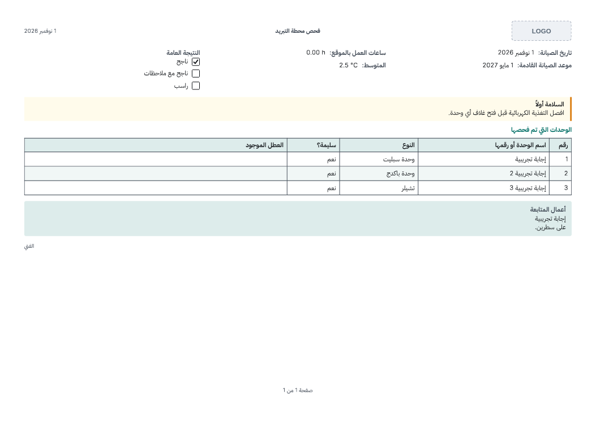

# Integr8 Forms for AI

A small program that lets AI coding tools — Claude Code, Codex, Claude Desktop, Cursor, VS Code
(GitHub Copilot), Windsurf and Gemini CLI — build Integr8 Plus forms and their PDF templates and
save them as `.integr8form` files, which staff then import into a company or the shared library
(form builder decisions 14 and 15, 1.3.0). It is an [MCP](https://modelcontextprotocol.io)
server that works **offline**: it never talks to an Integr8 Plus server, holds no credentials,
and reads files only where the AI passes a path. The one network request it ever makes is the
installer's check for a newer release on GitHub.

The program is `apps/forms-ai` (`@integr8/forms-ai`). It is released with the app, at the app's
version, so a tool and a server of the same version always agree on the file format.

## For staff

1. Open the download page (`/download` on the web app) and, under **Integr8 Plus Staff**, take
   **Integr8 Forms for AI** for your computer: Windows, macOS (Apple silicon or Intel) or Linux.
2. Double-click it. It is not signed, so the computer warns the first time:
   - **Windows**: "Windows protected your PC" → **More info** → **Run anyway**.
   - **macOS**: a browser does not keep a downloaded program runnable, so once, in Terminal:
     `chmod +x ~/Downloads/integr8-forms-ai-*-macos-*`. Then right-click the file → **Open** →
     **Open** (or System Settings → Privacy & Security → **Open Anyway**; or
     `xattr -d com.apple.quarantine ~/Downloads/integr8-forms-ai-*-macos-*`).
   - **Linux**: `chmod +x integr8-forms-ai-*-linux-x64` and run it in a terminal.
3. A terminal window opens. The program copies itself to a fixed place (below), lists the AI
   tools it finds, and asks which to connect: arrow keys to move, **Space** to tick, **Enter**
   to confirm. It then runs a self-test and prints **Ready ✓** for each connected tool.
4. Restart the AI tool (or start a new chat) and ask, for example: _"Use integr8-forms to build a
   boiler service form with a PDF certificate, in English and Arabic."_ The AI reads the format
   guide, checks its work, looks at PDF previews and saves the file.
5. Finished files are in **Documents/Integr8 forms** (change it from the installer's menu). Import
   one from the company's Forms page (as a new draft) or the dashboard's Templates page.

Open the downloaded file (or the installed copy) again at any time to connect more tools,
disconnect them, re-run the self-test, change the output folder or see the version. When a newer
release exists, it offers to update; nothing is downloaded without a yes.

PDF previews use Chrome, Edge or Chromium already on the computer. Without one, everything else
works and the AI is told there are no previews. `INTEGR8_FORMS_BROWSER` names a browser
explicitly.

### Where things go

| What                   | Windows                                                | macOS                                             | Linux                                  |
| ---------------------- | ------------------------------------------------------ | ------------------------------------------------- | -------------------------------------- |
| The program            | `%LOCALAPPDATA%\Integr8\forms-ai\integr8-forms-ai.exe` | `~/Library/Application Support/Integr8/forms-ai/` | `~/.local/share/integr8/forms-ai/`     |
| Its settings           | `settings.json` beside the program                     | same                                              | same                                   |
| Saved packages         | `Documents\Integr8 forms`                              | `~/Documents/Integr8 forms`                       | your Documents folder `/Integr8 forms` |
| Previews, opened files | `%TEMP%\integr8-forms-ai\`                             | `$TMPDIR/integr8-forms-ai/`                       | `/tmp/integr8-forms-ai/`               |

### What each AI tool gets

Every tool runs the installed program with `serve`, under the name `integr8-forms`. Where a tool
has its own command for adding MCP servers, the installer uses it; otherwise it edits the tool's
user-level settings file, backs it up first (`<file>.integr8-backup-<date>-<time>`), and touches
only the `integr8-forms` entry — other servers, comments and formatting stay as they were.

| Tool                     | How                                                                                                                                                                                                      |
| ------------------------ | -------------------------------------------------------------------------------------------------------------------------------------------------------------------------------------------------------- |
| Claude Code              | `claude mcp add --scope user integr8-forms -- <program> serve` (removed with `claude mcp remove --scope user`)                                                                                           |
| Codex                    | `codex mcp add integr8-forms -- <program> serve`; without the command, `[mcp_servers.integr8-forms]` with `command` and `args = ["serve"]` in `~/.codex/config.toml` (`CODEX_HOME`)                      |
| Claude Desktop           | `mcpServers.integr8-forms = { command, args: ["serve"] }` in `claude_desktop_config.json` (`%APPDATA%\Claude`, the Store build's own folder, `~/Library/Application Support/Claude`, `~/.config/Claude`) |
| Cursor                   | `mcpServers.integr8-forms` in `~/.cursor/mcp.json`                                                                                                                                                       |
| VS Code (GitHub Copilot) | `servers.integr8-forms = { type: "stdio", command, args: ["serve"] }` in the user profile's `mcp.json` (`%APPDATA%\Code\User`, `~/Library/Application Support/Code/User`, `~/.config/Code/User`)         |
| Windsurf                 | `mcpServers.integr8-forms` in `~/.codeium/windsurf/mcp_config.json`                                                                                                                                      |
| Gemini CLI               | `gemini mcp add --scope user integr8-forms <program> serve`; without the command, `mcpServers.integr8-forms` in `~/.gemini/settings.json`                                                                |

To connect a tool by hand, give it the same: command = the installed program, arguments =
`serve`, transport stdio.

## The tools the AI sees

| Tool               | Does                                                                                                                                                                                                                                            |
| ------------------ | ----------------------------------------------------------------------------------------------------------------------------------------------------------------------------------------------------------------------------------------------- |
| `get_format_guide` | The format, by section: question types and every option, rules, calculations, repeating sections, Information blocks, English and Arabic, PDF templates (blocks, placeholders, header and footer, look, fonts, landscape), limits, JSON Schemas |
| `list_examples`    | The six library forms, two more (the demo service report, a form using every 1.3.0 feature) and three PDF templates                                                                                                                             |
| `get_example`      | One of them as JSON                                                                                                                                                                                                                             |
| `new_picture_ids`  | Fresh ids for the pictures a template uses                                                                                                                                                                                                      |
| `check_form`       | The publish compile (`checkFormPackage`): every problem with its JSON path and code, and warnings such as missing Arabic                                                                                                                        |
| `check_package`    | The form, its templates checked against it as the API checks them, and the pictures against the templates                                                                                                                                       |
| `preview_pdf`      | Prints one template with sample answers as the server would, returns the PDF's path and pictures of its first pages                                                                                                                             |
| `save_package`     | Writes `<output folder>/<title>.integr8form` and reports the check; refuses to replace a file unless asked                                                                                                                                      |
| `open_package`     | Reads a `.integr8form` for editing: definition, settings, templates, and its pictures written out with their paths                                                                                                                              |

The guide's lists come from the same schemas and registries Integr8 Plus validates with
(`@integr8/form-engine`, `@integr8/document-render`, `@integr8/form-package`); its prose is keyed
by those registries' types, so a new question type, rule kind or block fails the type check and
`guide.test.ts` until it is described.

## For maintainers

### How it is built

```
src/cli.ts            setup (default) | serve | --version
src/mcp/              the MCP server: tools, guide, examples, check output, save/open, preview
src/preview/          finding Chrome/Edge, a minimal DevTools-protocol client, printing, pdf.js pictures
src/setup/            the installer: menus, tool adapters, JSON/TOML edits, self-test, self-install, update
scripts/bundle.mjs    esbuild → dist/integr8-forms-ai.cjs (the version written in)
scripts/build-sea.mjs the single executable for this computer, with its .sha256
```

- **One file per OS.** The bundle is a Node [single executable application](https://nodejs.org/api/single-executable-applications.html):
  `node --experimental-sea-config`, the blob injected into a copy of Node with `postject`, and on
  macOS an ad hoc signature (`codesign --sign -`), without which Apple Silicon refuses to run it.
  pdf.js and the website fonts travel as SEA assets (`src/assets.ts`; read from node_modules
  when run from source).
- **Printing like the server.** The API prints with Playwright; a bundled executable cannot carry
  Playwright (it reads its own files at run time), so `src/preview/cdp.ts` speaks the few
  DevTools-protocol calls Playwright makes for `page.pdf()` over `--remote-debugging-pipe`.
  `renderDocumentHtml`, the header/footer look, the two-print first page and the background
  underlay are the server's own (apps/api/src/documents). The page pictures are of the printed
  PDF, drawn by pdf.js in the same browser. Two differences: the Noto fonts come from the
  computer (the server has them installed), and a WebP background is turned into PNG by the
  browser rather than by sharp.
- **The installer** is hand-rolled on Node's `readline` (arrow keys, Space, Enter; numbered
  questions when there is no terminal). The same steps run from flags for scripts:
  `setup --status | --install all|<ids> | --remove all|<ids> | --self-test | --output <folder> | --no-update-check`.
- **Updates** come from the repository's GitHub releases (`MinaLouisLeon/integr8-plus`,
  `INTEGR8_FORMS_REPOSITORY` to change it, `INTEGR8_FORMS_NO_UPDATE_CHECK=1` to stop it). The
  newest `vX.Y.Z` release with this computer's file and its `.sha256` is offered; the download is
  checked against the hash and put at the installed path (the running copy is moved aside, which
  Windows allows), so every AI tool keeps working. A nightly build never offers releases.

Environment variables (all optional): `INTEGR8_FORMS_OUTPUT` (output folder for one run),
`INTEGR8_FORMS_BROWSER`, `INTEGR8_FORMS_HOME` (install folder, for tests),
`INTEGR8_FORMS_REPOSITORY`, `INTEGR8_FORMS_NO_UPDATE_CHECK`.

### Adding an AI tool

Add an adapter to `src/setup/tools.ts` and list it in `TOOLS`:

- A tool configured by a JSON file: `jsonAdapter({ id, name, detect, files, section, entry })` —
  the folders that show it is installed, its user-level settings file per OS, the key that holds
  its servers, and the entry it needs. `jsonc.ts` does the edit.
- A tool with its own command: write `status`, `install` and `remove` with `ctx.runner`
  (see `CLAUDE_CODE`, `CODEX`, `GEMINI`), falling back to its file when the command is missing.

Then add it to the `ToolId` union, a case in `tools.test.ts` over a fixture settings file
(install beside another server, idempotent, removal restoring the file, backup made), and a row
in the table above.

### Release build

The version release (`release-main.yml` → `build-release-artifacts.yml`, job **Forms for AI**)
builds the executable on GitHub's runners for Windows x64, macOS arm64, macOS x64 (Intel), Linux
x64 and Linux arm64, and the release attaches each as
`integr8-forms-ai-<version>-<windows|macos|linux>-<x64|arm64>[.exe]` with its `.sha256`. The
nightly gets them too. Set the repository variable `FORMS_AI_BUILDS=disabled` to skip the job.
The `/download` page lists them in the staff section from the newest staff release that has them
(`apps/web/src/lib/desktop-updates.ts`, `formsAi`).

Locally:

```bash
pnpm --filter @integr8/forms-ai... build        # the packages it bundles, then the bundle
pnpm --filter @integr8/forms-ai sea             # dist/release/integr8-forms-ai-<version>-<os>-<arch>
node apps/forms-ai/dist/integr8-forms-ai.cjs serve   # the server from the bundle, no executable
```


